# Лабораторная работа №2

## 🏹Описание модели

	Данная компьютерная модель представляет собой симуляцию попадания снаряда в бронелист (преграду) и предназначена для исследования возможности пробития снарядом брони при различных вводных параметрах, 
например, скорости снаряда, толщины преграды и т.п.
	Модель построена на методе динамики частиц - снаряд представляет собой совокупность гранул и при пробитии преграды может распадаться и деформироваться (геом. размеры снаряда задаются пользователем). 
Преграда представляет собой плоскую пластину из N гранул, расположенных горизонтально и взаимодействующих по контактной модели на основе перекрытия частиц. Уравнение движения для каждой частицы описывается вторым 
законом Ньютона. При решении уравнений движения применяется метод численного интегрирования Верле.

## ⌨Инструкция по запуску

	Модель написана на языке программироания Python и  может быть запущена в большинстве интерактивных IDE. 
Пользователь с клавиатуры вводит размеры поля, начальное положение снаряда и угол его вектора скорости относительно нормали преграды. В модели используется оптимизация расчётов с помощью 
параллелизации по потокам процессора, поэтому дополнительно задаётся то количество, которое непосредственно будет принимать участие в расчёте.

## 📃Структура данных

**Входные параметры:** 
* масса одной гранулы; 
* жёсткость контакта; 
* коэффициент нормального демпфирования; 
* коэффициент трения; 
* коэффициент касательного демпфирования; 
* сила отрыва стенки; 
* сила отрыва снаряда; 
* толщина одного слоя преграды; 
* координата нижнего слоя преграды; 
* количество слоёв; диаметр снаряда; 
* длина цилиндрической части снаряда; 
* длина конической части снаряда; 
* скорость снаряда; 
* шаг по времени интегрирования; 
* размеры расчётной области; 
* начальное положение снаряда; угол падения снаряда.

**Выходные параметры:**
* GIF-анимация, состоящая из отдельных PNG-рисунков, которые сохраняются в отдельную папку.

## 🗂Структура репозитория

* 'README.md' - текущий файл
* 'shell.py' - 
* 'gif/' - папка с анимациями
* 'frames/' - папка с рисунками, из которых состоит анимация

## 📊Результаты эксперимента

Здесь представлены анимации, соответствующие каждому случаю.

> 💡 *Для просмотра анимаций дождитесь полной загрузки страницы. Если интернет-соединение медленное, загрузка 16 гифок может занять некоторое время.*

<table>
  <!-- Строка 1 -->
  <tr>
    <td width="50%" align="center">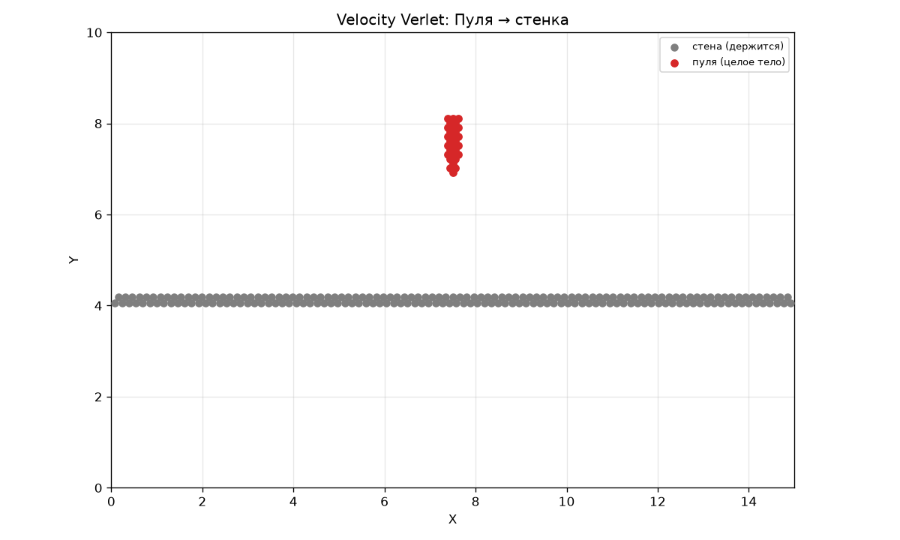 Shell1</td>
    <td width="50%" align="center">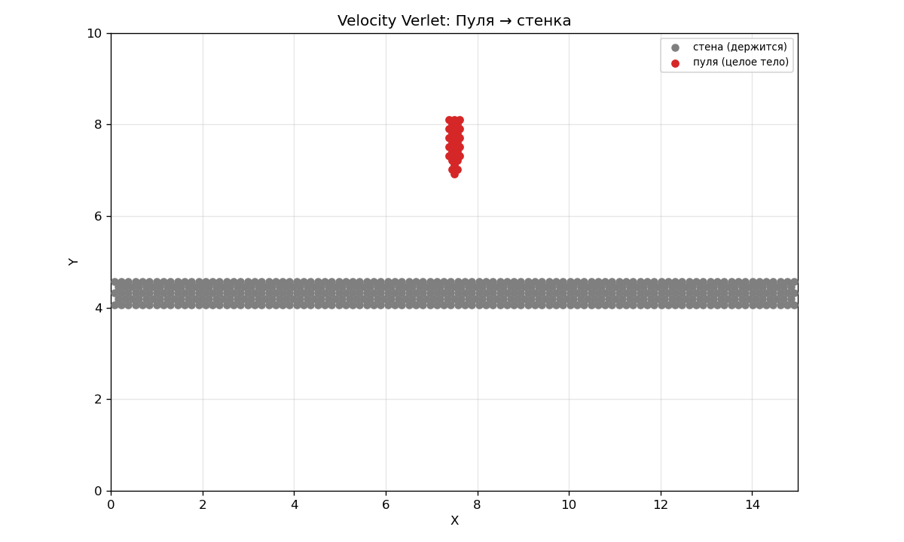 Shell2</td>
  </tr>
  <!-- Строка 2 -->
  <tr>
    <td width="50%" align="center">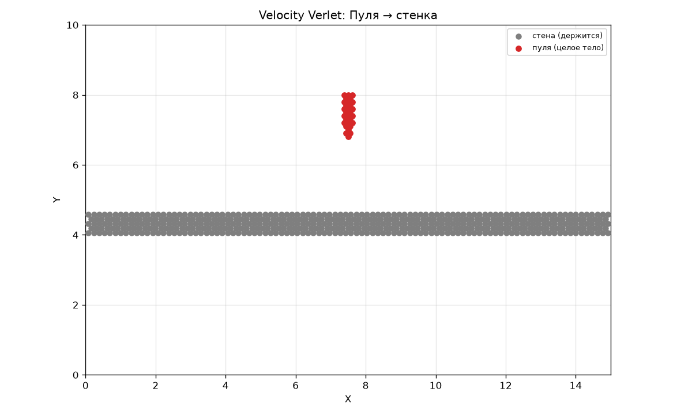 Shell3</td>
    <td width="50%" align="center">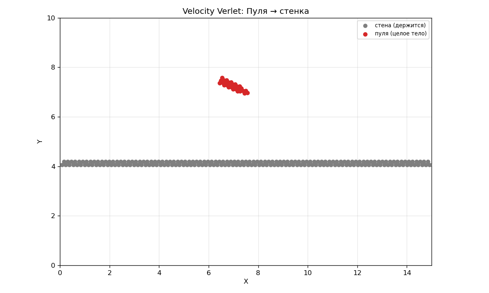 Shell4</td>
  </tr>
  <!-- Строка 3 -->
  <tr>
    <td width="50%" align="center">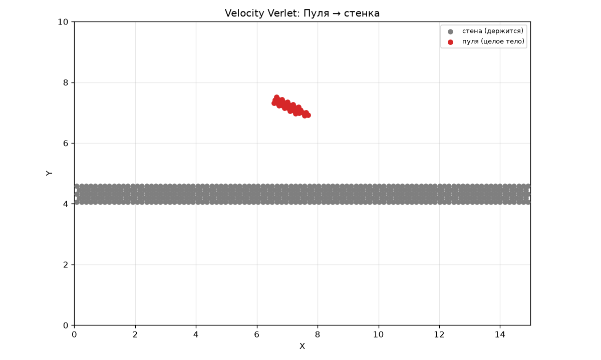 Shell5</td>
    <td width="50%" align="center">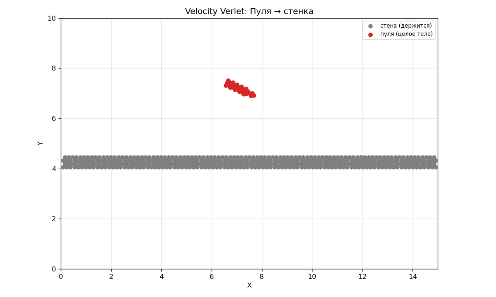 Shell6</td>
  </tr>
  <!-- Строка 4 -->
  <tr>
    <td width="50%" align="center">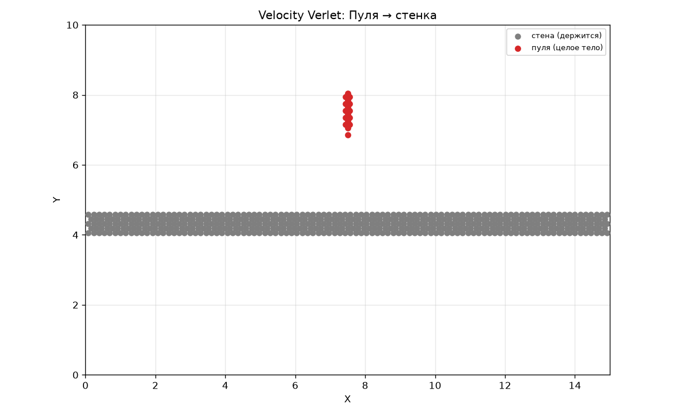 Shell7</td>
    <td width="50%" align="center">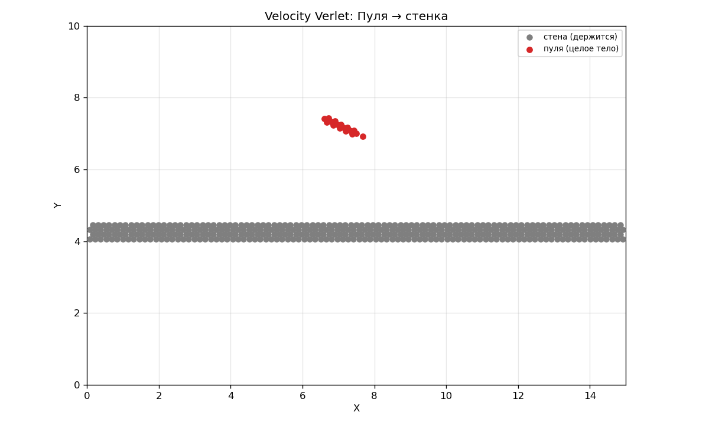 Shell8</td>
  </tr>
  <!-- Строка 5 -->
  <tr>
    <td width="50%" align="center">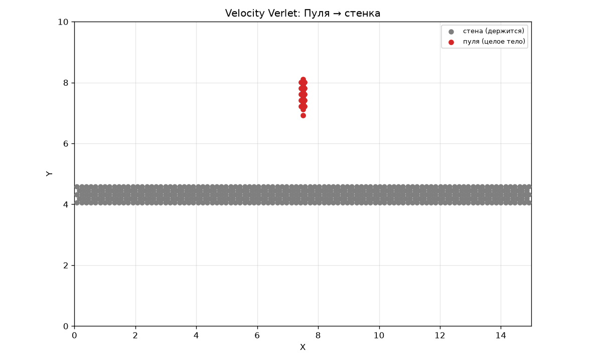 Shell9</td>
    <td width="50%" align="center">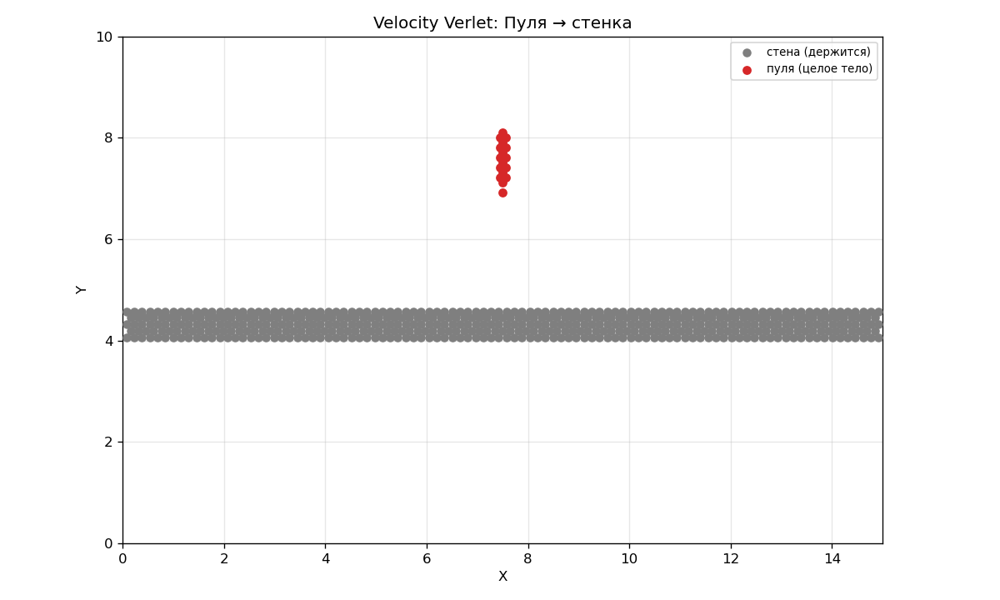 Shell10</td>
  </tr>
  <!-- Строка 6 -->
  <tr>
    <td width="50%" align="center"> Shell11</td>
    <td width="50%" align="center"> Shell12</td>
  </tr>
  <!-- Строка 7 -->
  <tr>
    <td width="50%" align="center">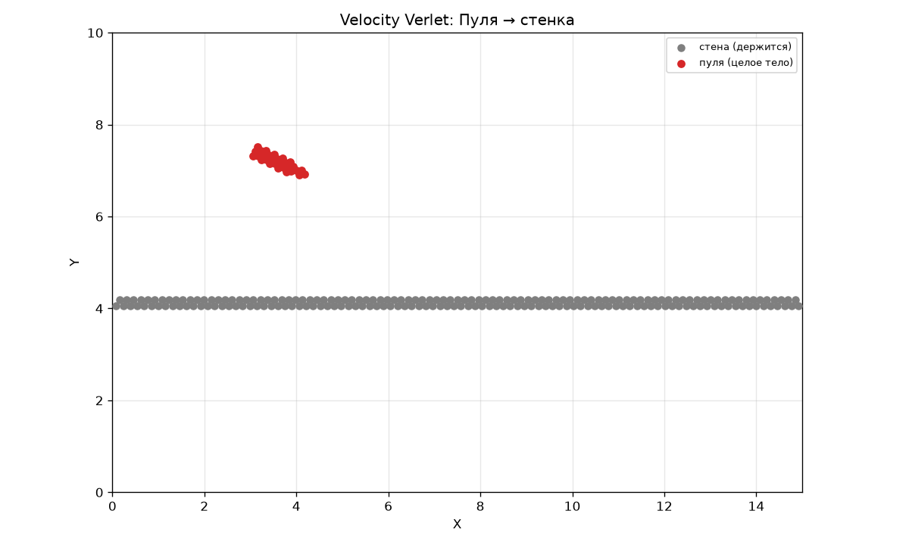 Shell13</td>
    <td width="50%" align="center">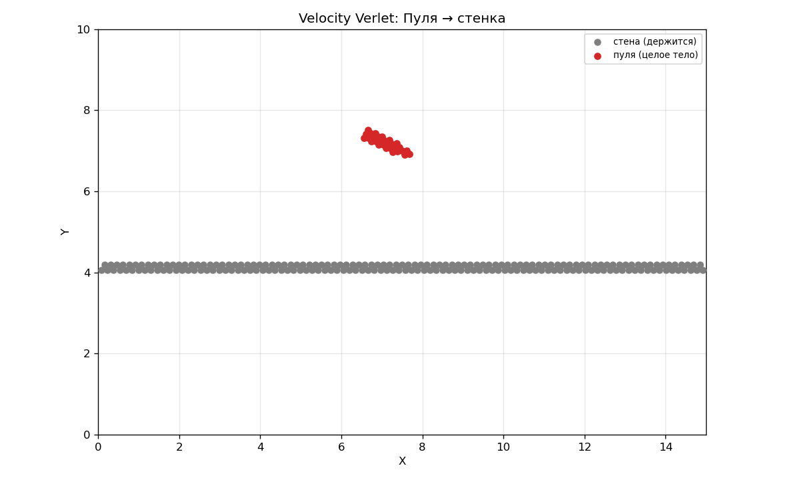 Shell14</td>
  </tr>
  <!-- Строка 8 -->
  <tr>
    <td width="50%" align="center"> Shell15</td>
    <td width="50%" align="center">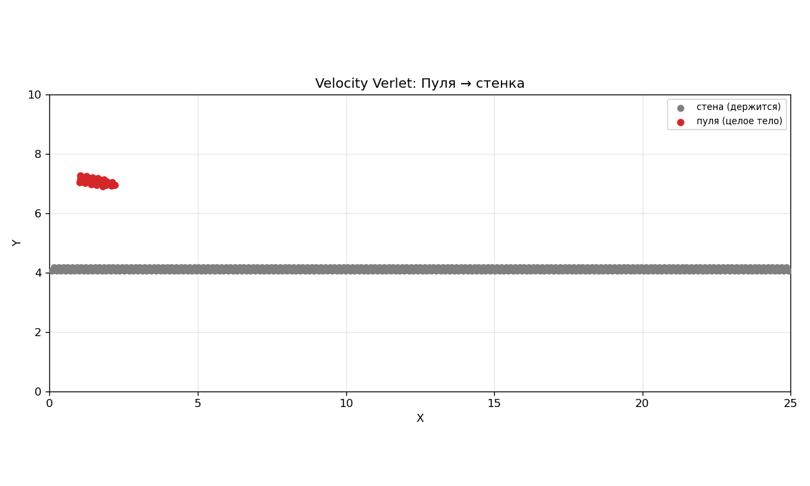 Shell16</td>
  </tr>
</table>

